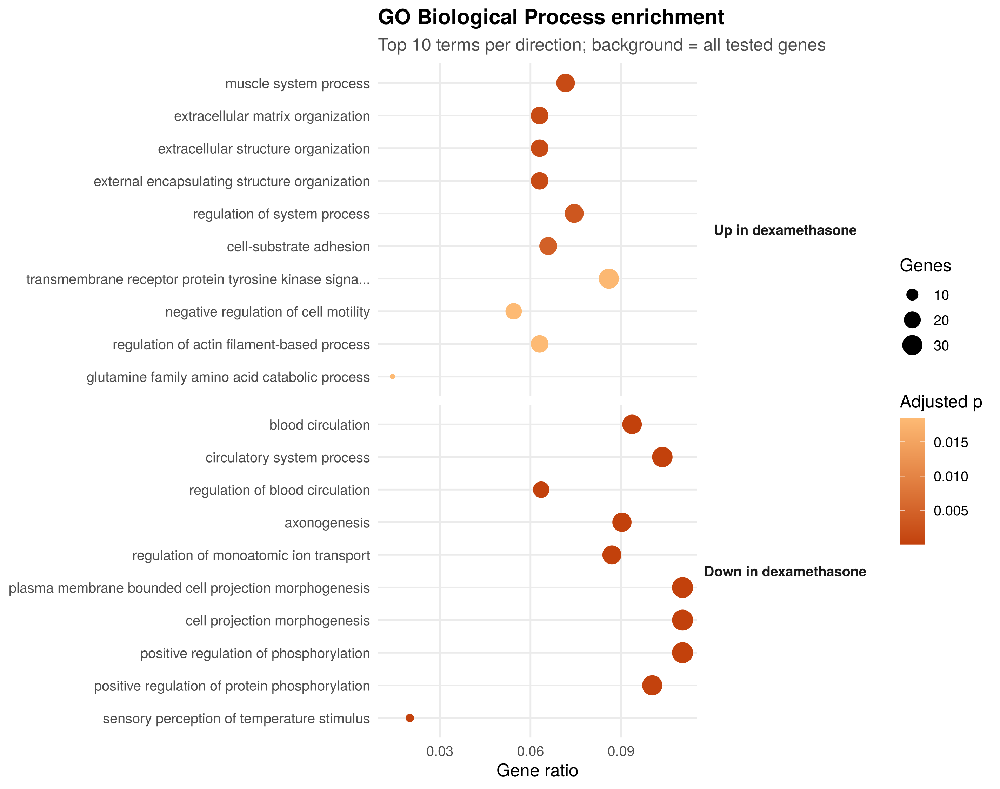
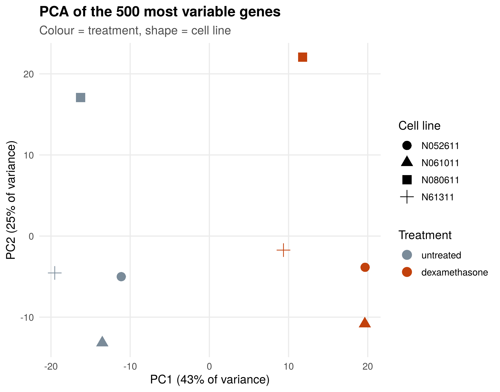
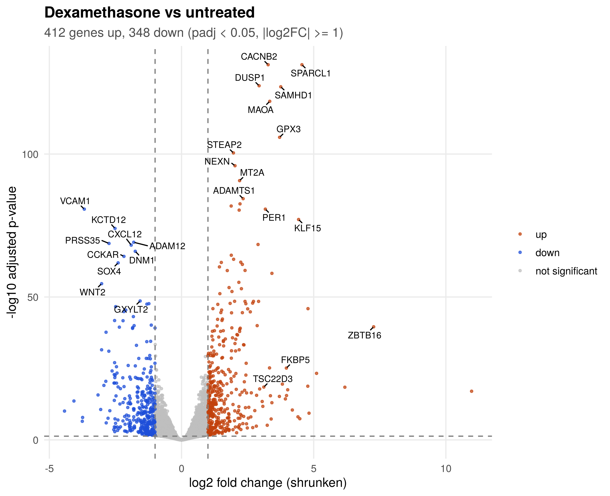
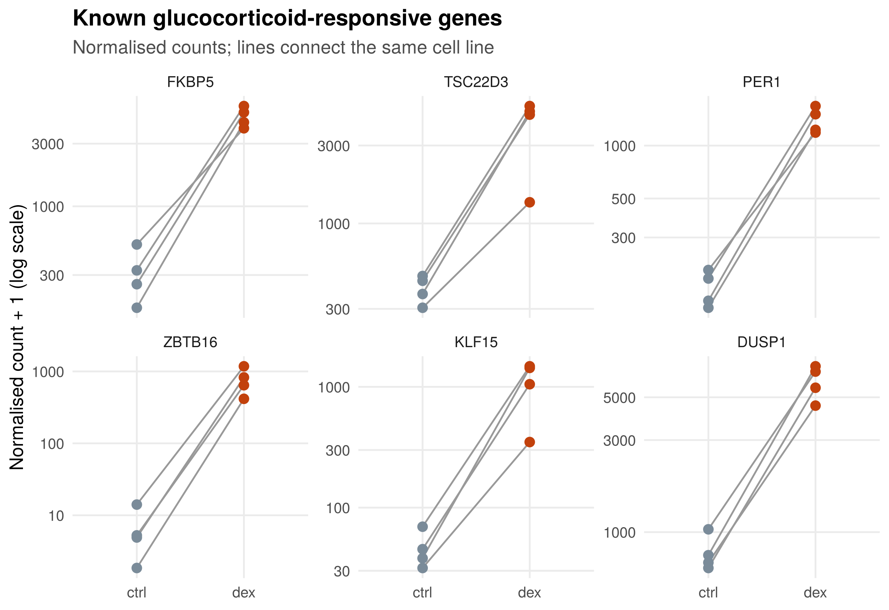
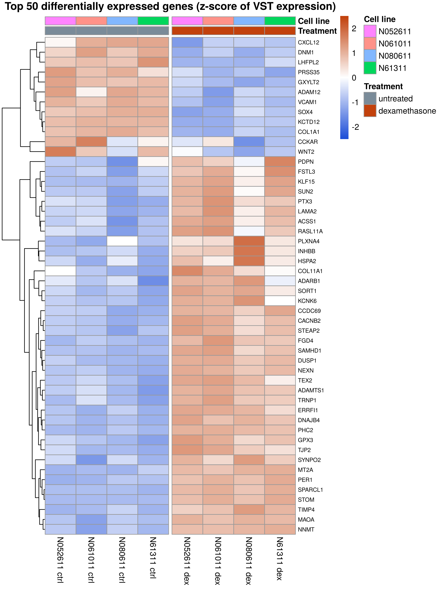

# How does dexamethasone change gene expression in airway smooth muscle cells?

An end-to-end bulk **RNA-seq differential expression** analysis of a public dataset, from raw
reads to biological interpretation, written to be fully reproducible.

**Data:** Himes *et al.* (2014) *PLoS ONE* 9:e99625 · GEO [GSE52778](https://www.ncbi.nlm.nih.gov/geo/query/acc.cgi?acc=GSE52778)
Primary human airway smooth muscle cells from **4 donors (cell lines)**, each **untreated** and
**treated with dexamethasone** (1 µM, 18 h), a glucocorticoid used to treat asthma.
8 samples, paired-end Illumina reads.

## Key results

| | |
|---|---|
| Genes tested | 16,139 |
| Significant (padj < 0.05) | 4,081 |
| Significant and ≥ 2-fold change | **760** (412 up, 348 down) |
| Top genes | *SPARCL1*, *CACNB2*, *DUSP1*, *SAMHD1*, *MAOA*, *GPX3* |

**Positive control:** all six classic glucocorticoid-responsive genes checked were strongly induced in
all four donors: *ZBTB16* (log2FC 7.3, ~150-fold), *KLF15* (4.4), *FKBP5* (4.0), *PER1* (3.2),
*TSC22D3*/GILZ (3.1) and *DUSP1* (2.9). This confirms that the treatment worked and the analysis
recovers the expected biology.

**Pathways (GO Biological Process):** up-regulated genes are enriched for *muscle system process*,
*extracellular matrix organisation* and *cell–substrate adhesion* (44 terms in total);
down-regulated genes for *blood circulation*, *cell projection morphogenesis* and
*positive regulation of phosphorylation* (184 terms in total).



| PCA | Volcano plot |
|---|---|
|  |  |
| **Known glucocorticoid-responsive genes** | **Top 50 genes** |
|  |  |

## Methods

**Phase 1: from published counts (R)**
- Gene-level counts from the Bioconductor package [`airway`](https://bioconductor.org/packages/airway/)
- Genes kept if ≥ 10 reads in ≥ 4 samples
- **DESeq2** with design `~ cell_line + treatment`. Each donor was measured both treated and
  untreated, so donor is a blocking factor (a **paired** analysis). This removes
  donor-to-donor differences and increases power.
- Log2 fold changes shrunk with **apeglm** for ranking and plotting
- Significance: Benjamini–Hochberg adjusted p < 0.05 and |log2FC| ≥ 1
- **GO Biological Process** over-representation (clusterProfiler), up- and down-regulated genes
  separately, against a background of all tested genes

**Phase 2: from raw reads (Linux / WSL)**
- Reads downloaded from SRA (`sra-tools`), by default 2 million read pairs per sample
- **FastQC + MultiQC** for read quality
- **Salmon** (selective alignment, GC-bias correction) against the GENCODE human transcriptome
- **tximport** to summarise transcripts to genes, then the same DESeq2 analysis
- Fold changes compared with Phase 1 to check the two pipelines agree

## How to run

### Phase 1 (Windows, Mac or Linux: R only)
1. Install [R](https://cran.r-project.org/) and [RStudio](https://posit.co/download/rstudio-desktop/).
2. Download this repository (**Code → Download ZIP**) and unzip it.
3. In RStudio: **Session → Set Working Directory → Choose Directory…** and pick the project folder.
4. In the console:
   ```r
   source("install_packages.R")   # once, about 10 minutes
   source("run_phase1.R")         # about 2 minutes
   ```
5. Results appear in `results/tables` and `results/figures`.

### Phase 2 (Linux, macOS, or Windows with WSL)
```bash
conda env create -f envs/phase2.yml
conda activate rnaseq-airway
bash run_phase2.sh 2000000 4        # read pairs per sample, CPU threads
```
By default only protein-coding transcripts are indexed (`PROTEIN_CODING_ONLY=1`), so Salmon runs on
a laptop with 8 GB RAM. Use `PROTEIN_CODING_ONLY=0` for the full transcriptome (about 16 GB RAM).

## Repository layout
```
R/01_get_counts.R        counts from the airway package or from Salmon (tximport)
R/02_deseq2.R            DESeq2, shrinkage, annotation, summary
R/03_figures.R           PCA, sample distances, MA, volcano, heatmap, marker genes
R/04_enrichment.R        GO enrichment (clusterProfiler)
R/05_compare_phases.R    Phase 1 vs Phase 2 agreement
scripts/01-03_*.sh       SRA download, FastQC/MultiQC, Salmon
run_phase1.R, run_phase2.sh, install_packages.R, envs/phase2.yml
data/samples.tsv         sample sheet (SRA run, donor, treatment)
results/                 tables and figures
```

## Interpretation

## Interpretation

**1. Dexamethasone has a strong, consistent effect.**
In the PCA plot, the biggest source of variation (PC1, 43%) separates treated from untreated
samples. All four donors respond in the same direction, even though they differ from each other.
760 genes changed at least 2-fold (412 up, 348 down).

**2. The analysis finds the genes we expect.**
Genes that are known to be switched on by steroids all went up strongly in every donor:
- *FKBP5*: the cell's "brake" on the steroid receptor (negative feedback). It is the classic
  marker that a steroid is working.
- *TSC22D3* (also called GILZ) and *DUSP1*: two well-known **anti-inflammatory** genes.
  GILZ blocks inflammatory signalling (NF-κB), and DUSP1 switches off inflammatory
  kinases (MAPKs).
- *ZBTB16*, *KLF15* and *PER1*: other well-known steroid-response genes; *ZBTB16*
  increased about 150-fold.

Finding these genes is a positive control: it shows the data and the analysis are working.

**3. This helps explain how steroids treat asthma.**
Anti-inflammatory genes go up (*DUSP1*, *TSC22D3*), while genes that help inflammation go down,
for example *VCAM1* (helps immune cells stick to tissue) and *CXCL12* (attracts immune cells).
The pathway analysis agrees: down-regulated genes are enriched for *positive regulation of
phosphorylation*, which fits with signalling being dampened.

**4. The airway muscle cells themselves are reshaped.**
Up-regulated genes are enriched for *muscle system process*, *extracellular matrix
organisation* and *cell–substrate adhesion*. Dexamethasone therefore changes not only
inflammation but also how the muscle cells build and attach to their surroundings, which matters
for airway remodelling in asthma.

**5. My results agree with the original study.**
Himes et al. (2014) highlighted *CRISPLD2* as a steroid-induced gene linked to asthma. In my
analysis *CRISPLD2* is also strongly increased (log2FC 2.6, about 6-fold).

**6. Why the paired design matters.**
Donors differ from each other (PC2, 25% of the variation). Because every donor was measured both
with and without the drug, including donor in the model (`~ cell_line + treatment`) compares each
donor with itself. This removes donor differences and makes the drug effect easier to detect.

**Conclusion:** in airway smooth muscle cells, dexamethasone switches on a clear
anti-inflammatory programme and changes genes involved in muscle function and tissue structure.
This is consistent with how inhaled steroids reduce airway inflammation in asthma.
## Limitations
- Four donors only, one dose and one time point
- Expression change does not equal protein or functional change
- Phase 2 uses a subset of reads by default, which reduces power for weakly expressed genes

## Author
**Alva Melita Alwin** · MSc Bioinformatics & Computational Biology, University College Cork ·
5 years of NGS library preparation at MedGenome
